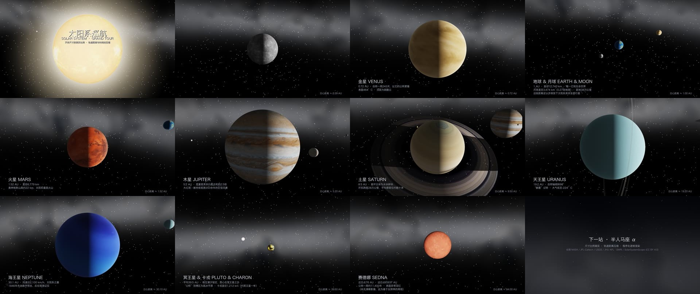

# 太阳系之旅 · Solar System Grand Tour

一段 96 秒、1080p/24fps 的太阳系飞掠短片：飞行器视角从太阳出发，依次掠过
**水星 → 金星 → 地球与月球 → 火星 → 木星 → 土星 → 天王星 → 海王星 → 冥王星与卡戎 → 赛德娜**，
最终驶离黄道，望向 4.24 光年外的**比邻星**与银河星空。一镜到底，无跳切。

[](video/solar_system_tour.mp4)

**▶ 点击上方图片观看成片**（也可直接打开 [`video/solar_system_tour.mp4`](video/solar_system_tour.mp4) 在线播放）

> 本片全部画面与音轨均由 AI 助手 **GLM-5.3-Flash（Z.ai）** 编写的 Python 程序
> 逐帧渲染生成——没有使用任何网络视频素材、第三方渲染器或剪辑软件；
> 唯一引用的外部资源是公开的行星表面贴图（见文末来源）。

## 特性

**物理设定**
- 天体 **1:1 真实尺寸比例**（太阳半径为显示压缩，片头字幕已声明）；轨道距离按幂律压缩 `r = 60·AU^0.45`
- 太阳是场景中**唯一点光源**：行星昼夜相位、月相、卫星照明、土星环投影到行星与行星投影到环，全部由几何关系自动导出
- 天王星 97.8° 侧躺与竖立的 ε 环；土星环径向剖面、卡西尼缝与视线遮挡
- **地月同框**与**冥王星-卡戎双星同框**构图；月球心形朝向地球（潮汐锁定）
- 赛德娜段回望时内行星与海王星均不可见，符合真实视线几何；终章按真实天区位置标注比邻星（星等 11，肉眼不可见——仅加标注环，不改变其亮度物理）

**渲染与运镜**
- 纯 CPU 程序化渲染：numpy 逐帧光线求交 + PIL 后处理，单机约 11 分钟渲完全片 2304 帧
- 相机位置用**切线限幅 Hermite 样条**（C1 连续、无过冲抖动），注视方向用 nlerp/Rodrigues 球面插值，全片无关键帧跳变
- ACES 色调映射 + 辉光 + 暗角 + 胶片颗粒
- 星空：**60,000 颗**按幂律星等与黑体色温分布的恒星（逐帧点渲染，不随镜头模糊）+ 程序化银河带（方向对准半人马座，与事实一致）
- 音轨（和弦垫 + 引擎低鸣 + 交会拂过声）在**最终时间轴上原生合成**，杜绝重采样高频啸叫

## 目录结构

```
.
├── solar_tour.py            # 全部渲染代码（单文件，约 1100 行）
├── requirements.txt
├── textures/                # 行星表面贴图（程序唯一引用的外部资源）
└── video/
    ├── solar_system_tour.mp4   # 成片（96s · 1080p24 · H.264+AAC）
    ├── poster.jpg              # README 海报（12 个代表镜头）
    └── tour_audio.wav          # 构建产物，已被 .gitignore 排除
```

运行期会在本地生成 `frames/`（渲染帧缓存）、`preview/`（预览图）与 `sky.npz`（星空缓存），均已 gitignore。

## 运行

```bash
pip install -r requirements.txt        # numpy, Pillow, imageio-ffmpeg（或有 ffmpeg 在 PATH 中）

python solar_tour.py preview 28 47 76.5 93.5   # 快速预览指定秒（输出到 preview/）
python solar_tour.py render                    # 全片渲染 2304 帧（6 进程，约 11 分钟）
python solar_tour.py audio                     # 合成音轨 → video/tour_audio.wav
python solar_tour.py encode                    # 编码 → video/solar_system_tour.mp4
```

时间轴、相机关键帧与各天体参数集中在 `build_path()` 与 `POS`/`LAM` 中，改总时长只需调整 `DUR` 与关键帧表。

## 贴图来源

行星贴图为 NASA 影像衍生的公开资源（Solar System Scope textures 等）；
地球使用 turban/webgl-earth 的 4K 无云贴图与 alpha 云图，冥王星贴图由新视野号全球拼图裁剪，
卡戎贴图为灰度地形图程序化上色。版权归原作者所有，仅作渲染演示用途。
